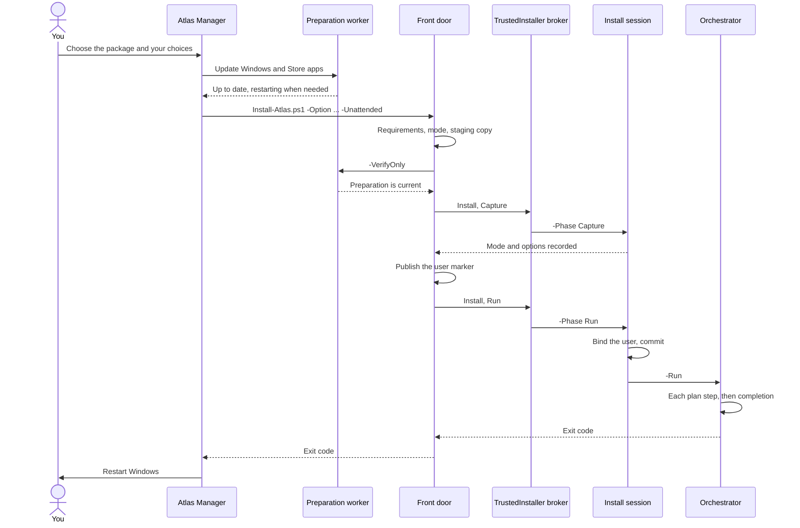

# Atlas architecture

This page explains how an Atlas install runs, where each part lives in the repository and the rules the shared code relies on.
It's for contributors and maintainers, and links to a reference page for each part.

## Terms

| Term | Meaning |
| --- | --- |
| Fresh | The first install of Atlas on a Windows installation. |
| Upgrade | An update from an older Atlas version that `UpgradableFrom` in `playbook.conf` lists. |
| Reapply | A reinstall of the installed version, so that a new build's fixes reach the PC. |
| Rebase | Putting Atlas back after Windows rebuilt itself while Atlas Manager moved it to a newer release. |
| Keep my choices, Choose again | The two update paths. An update either keeps every choice as the PC has it, or applies new answers wherever the PC differs. |
| Capture | The first TrustedInstaller phase of an install. It decides the mode and update path and records the options. |
| Run | The second TrustedInstaller phase. It binds the installing user, commits the install state and runs the install plan. |
| Front door | `Entry/Install-Atlas.ps1`, the script Atlas Manager runs to install Atlas. |
| Broker | `Entry/Invoke-AtlasTrustedInstallerBroker.ps1`, which runs a fixed set of operations as TrustedInstaller. |
| **Get ready** page | Atlas Manager's first install step: the PC checks and the Windows and Microsoft Store updates. |
| Preparation | The updates and repairs the **Get ready** page runs through the preparation worker, `Preparation/Update-Windows.ps1`. |

Script paths on this page are relative to `playbook/Executables/AtlasModules/Scripts`.

## What runs where

Atlas Manager is the only way to install Atlas, and every install takes the same path.

1. **Atlas Manager** checks the PC, downloads and extracts the Atlas package and asks for your choices.
   On the **Get ready** page it runs preparation, and moves Windows to a newer release when the package needs it.
2. **The front door** runs elevated, as you.
   It checks the requirements, resolves the install mode, copies the package to a protected staging folder and runs a last preparation check.
3. **The broker** starts a TrustedInstaller process through native code.
   For an install, it runs `Install/Invoke-AtlasInstallSession.ps1` from the staging copy, once for each phase.
4. **Capture** decides the mode and the update path, checks the options against `playbook.conf` and begins the install state.
5. Between the phases, the front door publishes your user marker from your own session.
6. **Run** binds you as the installing user, commits the state and starts the orchestrator, `Entry/Invoke-AtlasInstall.ps1 -Run`, which works through the install plan.
7. **Completion** reads the PC, records what it has in the machine state document and closes the install state.

An ISO that Atlas Manager creates installs Windows, and Atlas Manager then installs Atlas through the same front door after the first sign-in.



Every change the install makes runs live, in that TrustedInstaller process or in a process it starts as the installing user.
Atlas code writes and checks every install fact.

These pages describe each part:

- [The front door](front-door.md): parameters, exit codes, requirement checks and running it by hand.
- [Install state and records](install-state.md): the install state, `state.json`, flags and toggle records.
- [Preparing Windows](preparation.md): the **Get ready** page and the preparation worker.
- [Moving Windows to a newer release](windows-transition.md): feature updates and Rebase.
- [Updating Atlas](upgrading.md): what an update changes and keeps, from your side.

## Repository layout

The script tree is organised by who starts a file.

```text
playbook/
├─ playbook.conf                     version, supported builds, update sources, requirements, option pages
└─ Executables/
   ├─ AtlasDesktop/                  the Atlas folder's launchers, mostly generated two-line .cmd stubs
   ├─ AtlasModules/
   │  ├─ Toggles/<Group>/<Name>.psd1 data-only toggle definitions, each with an optional <Name>.ps1 companion
   │  ├─ Toolbox/                    launcher stubs and assets that Toolbox releases before 0.2.0 open by path
   │  └─ Scripts/
   │     ├─ Initialize-AtlasPowerShell.ps1   the bootstrap every entry point dot-sources
   │     ├─ Compatibility/           the Windows release catalog and its check
   │     ├─ Entry/                   processes started from outside: the front door, the broker,
   │     │                           launchers, RunOnce, shell verbs and user tools
   │     ├─ Install/                 reachable only during an install
   │     │  ├─ Install-Plan.ps1      the ordered plan table
   │     │  ├─ Invoke-AtlasInstallSession.ps1   Capture and Run
   │     │  ├─ Phases/               one script per plan phase
   │     │  ├─ Tasks/                checkpoints and installing-user passes
   │     │  └─ Compat/               update-only cleanup of retired Atlas versions
   │     ├─ Operations/              scripts that run in their own process, started by path
   │     ├─ Modules/Atlas.*/         libraries
   │     ├─ Preparation/             the preparation worker, also embedded in Atlas Manager
   │     ├─ Tweaks/<category>/       data-only install tweaks and their companion scripts
   │     └─ Registry/                .reg files that toggles import
   └─ Themes/
app/                                 Atlas Manager (Rust, GPUI); see app/README.md
services/                            the Atlas reports service and its MCP server
tools/
├─ build/                            AtlasBuild, Build-Playbook, Test-Apbx, Set-AtlasVersion (PowerShell 7)
├─ dev/                              New-ToggleLaunchers, Export-AtlasCatalog, Compare-SystemState, Install-DevProfile
├─ lab/                              Invoke-AtlasLabRun: install and verify on a Hyper-V VM (PowerShell 7)
├─ native/                           Build-AtlasNative: a deterministic, signable build of Atlas.Native.cs
├─ release/                          the Linux cross-build setup and tester bundles
├─ release-zip/                      extra files packed beside the package in the release ZIP
├─ sxsc/                             CBS package sources
└─ timer/                            source build of the timer utilities in the Atlas package
tests/                               Pester 5 suites; the Windows PowerShell tests run under 5.1
docs/
```

The installed tree is `%windir%\AtlasModules`.
`tools/build/AtlasBuild` packs everything under `playbook/` into the Atlas package, apart from generated packages and known build artifacts.
The verifier compares source and archive paths and rejects missing, extra or changed files (see [Building the Atlas package](building.md)).
The SxS CABs built from `tools/sxsc` are reviewed before they're committed under `playbook/`, and their CBS package versions don't follow the Atlas version.

## One plan and one orchestrator

[`Install/Install-Plan.ps1`](../playbook/Executables/AtlasModules/Scripts/Install/Install-Plan.ps1) holds the only ordered install table.

| Step | Modes | Replay |
| --- | --- | --- |
| DefaultHiveLoad | All | Always |
| PayloadReplacement | All | Always |
| NotificationDisable | All | Always |
| RebaseRecovery | Rebase | Once |
| LegacyChoices | Upgrade, Rebase | Once |
| PreInstall | All | Once |
| ShellRefresh | All | Once |
| Environment | All | Once |
| Tweak: `qol/set-hidden-settings-pages` | Fresh | Once |
| InitializePath | All | Once |
| Features | All | Once |
| Software | All | Once |
| Services | Fresh, Rebase | Once |
| Components | Fresh, Rebase | Once |
| AppxSupport | Fresh, Rebase | Once |
| Choices | Upgrade and Reapply, only when choosing again | Once |
| Defaults | All | Once |
| Tweak: `qol/appearance/atlas-theme-upgrade` | Upgrade, Rebase | Once |
| Tweaks: networking, performance, privacy, qol, security, debloat, scripts, misc | All | Once |
| Tweak: `scripts/set-power-settings` | Fresh | Once |
| WindowsTransition | All | Once |
| InstallingUserSetup | All | Once |
| NotificationRestore | All | Always |
| DefaultHiveUnload | All | Always |

All means Fresh, Upgrade, Reapply and Rebase.
A Rebase gets the Upgrade plan plus the fresh-install phases the rebuild undid (see [Rebase](windows-transition.md#rebase)).
[Replay](install-state.md#replay) says when a resume runs a step again.

The orderings matter:

- PayloadReplacement replays every time, so a resume syncs the package's files before it skips completed steps.
  A rebuilt package can keep its version while it fixes a failed run.
- Choices runs only when an update or reinstall chooses again, through the step's `ChooseAgainModes` list.
  It comes after LegacyChoices and Software, so the old choices are read and a newly chosen browser is installed first.
  It comes before Defaults and the tweak categories, so they apply the records it writes.
- WindowsTransition comes after Defaults has replayed the recorded choices and `Tweaks/qol` has written the update pin.
  It puts back only the Windows Update settings nothing else owns (see [Putting Windows Update settings back](windows-transition.md#putting-windows-update-settings-back)).
- LegacyChoices and, on a reinstall, InstallingUserSetup stamp the other accounts for their sign-in migration (see [Sign-in migration stamps](install-state.md#sign-in-migration-stamps)).

The orchestrator, [`Entry/Invoke-AtlasInstall.ps1`](../playbook/Executables/AtlasModules/Scripts/Entry/Invoke-AtlasInstall.ps1), dispatches four fixed kinds of key and rejects any other.

| Kind | Key | Runs |
| --- | --- | --- |
| Phase | `<Name>` | `Install/Phases/Invoke-<Name>Phase.ps1` |
| Tweak category | `Tweaks/<category>` | `Invoke-TweaksPhase.ps1` for that category |
| Tweak | `Tweak/<slug>` | `Invoke-TweaksPhase.ps1 -Slug` for one standalone tweak, in its machine and default-user passes only |
| Checkpoint | `Checkpoint/<Name>` | A fixed `Install/Tasks` script |

It starts from the staging copy's scripts and switches to the installed ones once PayloadReplacement is complete.
Steps return to it instead of ending its process, and it reports progress as `[AtlasProgress] <done>/<total>` lines.
When every applicable key is complete, it calls `Complete-AtlasInstallState`, so the install state and its completed keys are the whole resume record.
It exits with 0 on success, 1 on an install failure and 2 on the wrong privilege.

### Phase responsibilities

| Phase | Main responsibility |
| --- | --- |
| PreInstall | Removes obsolete Atlas elevation artifacts and the old Atlas Toolbox's records outside the toggle store (`Install/Compat`), with limited machine and user cleanup |
| ShellRefresh | Refreshes the installing user's shell |
| Environment | Environment and runtime configuration |
| Features | Windows capabilities and optional features, and the Atlas packages' repair source (see [The component store and the Atlas packages](preparation.md#the-component-store-and-the-atlas-packages)) |
| Software | The chosen utilities, browsers and Atlas Toolbox |
| Services | Backs up Windows services, then applies and records the File Sharing, Location and Indexing defaults |
| Components | Component and browser cleanup, and the Defender choice through `Set-AtlasDefenderChoice`, which Choices shares |
| AppxSupport | Installed and provisioned AppX changes, and the installing user's cache work |
| Choices | Applies each install choice that differs from the PC, and records the toggles it set in `work\choices.json` |
| Defaults | Sets up the toggle store on a fresh install, or replays recorded toggles, leaving out those Choices set |
| Tweaks | One tweak category, or one standalone tweak, in machine, current-user and default-user scopes |

- Software installs the latest stable Atlas Toolbox release.
  Only a release candidate built with `--toolbox` carries its own Toolbox, in `AtlasModules\Bundled\Toolbox`, and installs that instead.
- Components doesn't install an Atlas CBS package again while servicing shows it installed or waiting for a restart.
  Keeping Defender takes off `Z-Atlas-NoDefender-Package`.
  A failed removal, or a NoDefender package still waiting for a restart, fails the install rather than report success on a PC with no antivirus.
- Choices applies Defender, then Edge, then the app families a choice removes, then the six choice toggles.
  A servicing or Edge failure fails the step at once, and toggle and app failures fail it together once every other choice is applied.
  The next attempt finishes an Edge or app removal an interrupted one began.

### AppX removals

`Remove-AppxPackage -AllUsers` can report success and leave a package registered to another account, to SYSTEM or to a deleted account.
So `Invoke-AtlasAppxRemovalPlan` (Atlas.Appx) reads both the installed and provisioned inventories again after each removal, instead of trusting the cmdlets.
It removes each leftover once more for every account that still has it, and looks again a few seconds later.

- A package still installed for the installing user, or still provisioned, fails the removal, and the error points to Settings > Apps.
- A package left only for other accounts, SYSTEM or no account, or whose removal Windows finishes later, is a warning naming the package and its accounts.
- Families marked `IgnoreErrors`, such as Edge's and the Widgets packages, only warn.

`Set-AtlasAppxDeprovisioned` then registers every removed and matched family under the AppX `Deprovisioned` key, so a feature update doesn't bring them back.
Its snapshot is in `Install\work`, so a resumed step keeps the families an interrupted attempt removed.

## Rules shared code relies on

### The bootstrap and paths

Every process entry point dot-sources [`Initialize-AtlasPowerShell.ps1`](../playbook/Executables/AtlasModules/Scripts/Initialize-AtlasPowerShell.ps1) before any command PowerShell could autoload.
It sets `PSModulePath` to the Atlas module tree and the inbox module root, then imports the four inbox modules Atlas uses from their exact manifests.
A module on a user's path therefore can't replace an Atlas or Microsoft module, or a command such as `Join-Path`.

- Entry scripts find the `Scripts` folder with `[IO.Path]::GetDirectoryName($PSScriptRoot)`, before the bootstrap has run.
- Operation, task and phase scripts run only inside an Atlas process that has loaded the bootstrap, so they may use `Split-Path -Parent $PSScriptRoot`, twice under `Install`.
- Scripts import modules by their exact manifest path.

### The installing user

Run binds the installing user from the marker the front door publishes (see [The user marker](front-door.md#the-user-marker)).
`Invoke-AtlasAsUser` relies only on that binding.
It runs only from SYSTEM or TrustedInstaller, asks WTS for the recorded session instead of listing sessions, and checks the returned token's SID and session.
It requires the user's profile hive to be loaded, starts only the inbox Windows PowerShell host with `CreateProcessAsUser`, and waits with a time limit for a child that can't detach.
Shell refresh, live `HKCU` work, AppX cache work and the other installing-user steps go through it.

### The HKCU rule

`HKCU` belongs to the current process's token, so each tweak category runs three explicit passes during its own step:

1. **Machine.** TrustedInstaller applies machine entries and companion work, without redirecting `HKCU`.
2. **Live user.** The installing user's process checks its own SID and writes its own `HKCU`.
3. **Default user.** TrustedInstaller writes the same declarations to the loaded `HKU\Atlas_DefaultUser` hive, with Atlas.Registry bound to the active transaction.
   Only TrustedInstaller with an active transaction may write it, and other `HKEY_USERS` targets are rejected.

DefaultHiveLoad and DefaultHiveUnload bracket every plan, and Atlas records that it owns the mount only after loading the hive.
After a failure, cleanup unloads a mount this run created and leaves any other.
New accounts get the default-user settings and run `Entry/Initialize-NewUser.ps1` at their first sign-in.

### Notifications during an install

The NotificationDisable and NotificationRestore checkpoints set the machine policy `NoToastApplicationNotification` for the install, with no per-user change.
They save the previous value in `work\notification.json` first, and a retry reuses that snapshot.
Restore writes the value back, or removes it, and checks it before deleting the snapshot.

### Native code

Every P/Invoke and COM declaration lives in [`Atlas.Core/Native/Atlas.Native.cs`](../playbook/Executables/AtlasModules/Scripts/Modules/Atlas.Core/Native/Atlas.Native.cs).
`Initialize-AtlasNativeType` loads it once per process, and callers don't call `Add-Type` themselves.
A prebuilt `Atlas.Native.dll` is used only when its Authenticode signature is valid, and releases include none because the project has no code-signing certificate.
Elevated and SYSTEM processes compile the source in a new folder whose access list admits only SYSTEM and Administrators.
TEMP and TMP point there meanwhile, so a folder the user can write can't feed code that runs as SYSTEM or TrustedInstaller.
Processes that aren't elevated compile directly.
See [Native assembly](building.md#native-assembly) for the build.

### PowerShell modules

Each setting and helper has one implementation, in a module under `Modules/Atlas.*`.

| Module | Responsibility |
| --- | --- |
| Atlas.Core | Data files, module import, install context, flags, logging, console vocabulary, privilege checks, launching as the user, the broker, native types |
| Atlas.State | The machine state document |
| Atlas.InstallState | Capture, the install state, step replay and completion |
| Atlas.Registry | Registry operations, identity scopes, declarative registry entries and their checks, execution policy |
| Atlas.Services | Service startup, declarative service entries and their checks, service backup and restore |
| Atlas.TasksProcs | Scheduled tasks and processes, declarative task entries and their checks |
| Atlas.Tweaks | Tweak loading, validation, applicability, scoped execution and checks |
| Atlas.Toggles | Toggle definitions, the toggle engine and state store, replay and drift checks |
| Atlas.Download | Limited HTTPS downloads, protected staging, contained native execution, GitHub and trusted WinGet resolution |
| Atlas.Appx | AppX operations, the user's cache work, Game Bar |
| Atlas.Software | Software and browser installers, CBS packages |
| Atlas.Shortcuts, Atlas.Themes | Shortcuts, themes |
| Atlas.Security | Defender package state, VBS and HVCI, Windows Temp permissions |
| Atlas.Hardware | The Atlas power plan, PnP devices |
| Atlas.Network | Network defaults, file sharing |
| Atlas.Search | Search index configuration, Store search recommendations |
| Atlas.Privacy | Location services, telemetry cleanup and component removal |
| Atlas.Shell | Settings page visibility, file associations, Send To, context menus, Start and taskbar pins, File Explorer Home pins |

- Companions and entry scripts import the module, with `Import-AtlasModule` inside companions, and call its function.
- A companion function doesn't share a name with the module function it calls, so it can't hide it.
- `Scripts/Operations` keeps only scripts that must run in their own process: elevated or contained child processes, package transactions, and user scripts that Windows or a launcher starts by path.

## Tweaks, toggles and verification

Install tweaks and Atlas folder toggles are data-only definitions that call the module functions.
Their schemas are in [the tweak schema](../playbook/Executables/AtlasModules/Scripts/Tweaks/README.md) and [the toggle schema](../playbook/Executables/AtlasModules/Toggles/README.md).
A tweak's `Toggle` key applies and records the machine part of a toggle state during the install, so the install and the launcher share one implementation.
`tools/dev/Export-AtlasCatalog.ps1` generates `Toggles\catalog.json`, the contract for Atlas Toolbox, and the [toggle and tweak references](catalog/toggles.md), and CI checks that they match the definitions.

### Launchers and console output

The Atlas folder's and the Toolbox's launchers are two-line `.cmd` stubs that `tools/dev/New-ToggleLaunchers.ps1` generates.
Each calls `Entry\Invoke-AtlasToggleLauncher.cmd` with the toggle name, the state and its own path.
That launcher anchors to the protected command host and cleans the environment with `Entry\Initialize-PowerShellLauncherEnvironment.cmd`.
It checks `/silent`, `/quiet`, `/justcontext` and `/noaction` before Windows PowerShell starts, then runs `Entry\Invoke-Toggle.ps1`.
The generator's `-Validate` run rejects any other hand-written `.cmd`, so a new one must be added to the list in that script and described here.

Three launchers are hand-written because no toggle describes them.
They call the same environment helper and reuse the `Ui.ps1` sentences for what they print.

- `Install AtlasOS Toolbox.cmd` and `4. Interface Tweaks\Start Menu\Install Open-Shell.cmd` start their own elevated installer.
  Install Open-Shell then restarts File Explorer in the caller's session.
- `9. Troubleshooting\Set services to defaults.cmd` forwards to `Entry\Invoke-AtlasResetServices.ps1`.

The toggle engine and the console vocabulary in `Atlas.Core\Domain\Ui.ps1` own what a run prints (see [Console presentation](console-presentation.md)).

### Verification

Apply and verify share one vocabulary, so every `Registry`, `Services` and `ScheduledTasks` declaration can be read back.
`Test-AtlasRegistryEntries`, `Test-AtlasServiceEntries` and `Test-AtlasScheduledTaskEntries` return one drift record, with its reason, for each declaration that no longer holds.
`Test-AtlasToggleState`, `Test-AtlasToggleDrift`, `Test-AtlasTweak` and `Test-AtlasTweakCategory` build on them, honouring each tweak's applicability conditions.
Companion functions and `Run` entries aren't checked.

[`Entry/Test-AtlasHealth.ps1`](../playbook/Executables/AtlasModules/Scripts/Entry/Test-AtlasHealth.ps1), the launcher `9. Troubleshooting\Check Atlas Health.cmd`, checks every recorded toggle state and applicable tweak, in machine scope and the calling user's `HKCU`.
It changes nothing and prints a report, or JSON with `-Json`.
It exits with 0 when it finds no drift, 1 when it does, and 2 when Atlas isn't installed or the check couldn't run.

Scheduled-task changes read the scheduler's language-neutral `Enabled` state before and after `schtasks.exe`, so verification doesn't depend on translated output.
Search indexing stages its URLs under `HKLM\SOFTWARE\AtlasOS\Search` while WSearch is stopped.
Once the service runs, it commits them through `ISearchCrawlScopeManager` and reads the saved scope back.
Includes end in a folder separator and exclusions in `\*`, following Microsoft's [scope rule format](https://learn.microsoft.com/windows/win32/search/-search-3x-wds-extidx-csm-scoperules).
Minimal or Full replaces earlier user scope overrides with Windows's defaults and the preset, and an administrator's Group Policy still wins.
Atlas leaves Windows's Gather scope records, its `CurrentPolicies` cache and Search setup alone.
`Get-AtlasIndexScopeState` reads the scope for reports without changing anything.

### Registry entry options

The [tweak schema](../playbook/Executables/AtlasModules/Scripts/Tweaks/README.md#registry-entries) defines the options. These notes add how the code uses them.

- `SkipVerification` is for values that only start transient Windows state, and verbose verification explains each entry it skips.
- `AllowOsProtected` applies only when the key opens and Windows refuses the value for every caller, TrustedInstaller included.
  Other registry failures stay fatal and name the entry.
- `UseGroupPolicy` writes through `IGroupPolicyObject`, so unrelated local policy stays, and checks `gpupdate` and the effective value.
  Widgets uses it for `AllowNewsAndInterests`, which covers the taskbar button as well as the board.
- `VerifyWithToggle` is read by `Get-AtlasUpgradeRegistryEntries` (`Atlas.Tweaks\Domain\Invoke.ps1`), which both applying on update and verification use.
  An update applies the override when the toggle's recorded state matches, so it doesn't bring back a restriction you lifted, and verification expects the same value.
  Current-user values are read from the account being checked.
  Location and Copilot use it for their enable choices.

### Start and taskbar pins

The installing user's setup sets Start and taskbar pins (`Atlas.Shell\Domain\Start.ps1` and `Taskbar.ps1`), and `Entry\Initialize-NewUser.ps1` does it for later accounts.

- Start uses the Configure Start Pins policy.
  On a build older than the servicing level that added the local policy, Atlas warns but still applies the layout and default-profile cleanup, so a later cumulative update can use them.
- Windows has no stable taskbar layout API, so the taskbar's binary values are a deliberate workaround, kept to the supported builds and tested again when they change.
- Every write is checked, and a value that can't be applied fails the user-setup checkpoint.
- A missing chosen browser falls back to Edge, then to File Explorer alone, and temporary shortcut staging is always removed.
- The File Explorer pin carries the `Microsoft.Windows.Explorer` AppUserModelID, and File Explorer refreshes after the pin database is committed, so open windows group under it.
  Setup also creates the `Atlas.lnk` desktop shortcut.
- For later accounts, the two-stage RunOnce setup removes its retry before it refreshes File Explorer, so the new shell can't start a second setup.
  The ready notification follows the last refresh.
- Setup registers OneDrive and cleans up its leftovers for each account, and leaves any sync root that holds files.

## Privileged operations after install

Tools that need TrustedInstaller after the install use the same native broker, which accepts four typed operations.

| Operation | Runs |
| --- | --- |
| Toggle | The installed `Entry\Invoke-Toggle.ps1` |
| ResetServices | The installed `Entry\Restore-AtlasServiceDefaults.ps1` |
| Install | `Install\Invoke-AtlasInstallSession.ps1` from a protected staging copy (see [The broker's Install operation](front-door.md#the-brokers-install-operation)) |
| CbsRetry | The installed `Operations\CbsRetry.ps1 -Recover` |

The caller gets the target's exit code, and diagnostics go to standard error.
The TrustedInstaller process has no standard handles, so its targets log their failure reason, and the broker relays the session log for Install.
`Scripts\RunAsTI.cmd` is a stub that refuses to run, kept for old shortcuts (see [Files kept for compatibility](compatibility.md)).

### Safe Mode and CBS retry

[`Operations/SafeMode.ps1`](../playbook/Executables/AtlasModules/Scripts/Operations/SafeMode.ps1) has four operations: Minimal, Networking, CommandPrompt and Exit.
It changes only boot configuration, through the System32 `bcdedit.exe`.
CommandPrompt sets `safeboot minimal` and `safebootalternateshell yes`, so Safe Mode starts Command Prompt while normal starts keep their shell.
Earlier Atlas builds set the Winlogon shell to `cmd.exe` and saved the original in `%windir%\AtlasOS\Recovery\SafeMode.json`, and every operation puts that shell back and deletes the file.

[`Operations/CbsRetry.ps1`](../playbook/Executables/AtlasModules/Scripts/Operations/CbsRetry.ps1) recovers failed CBS packages:

1. Atlas records the packages' full paths in `%windir%\AtlasOS\Recovery\CbsRetry.json`, in the Pending state.
2. Setting CommandPrompt Safe Mode arms the retry.
   It also sets the machine-wide `PROMPT` variable to the retry instruction, saving the old value in `CbsRetryPrompt.json` for when the retry leaves Safe Mode.
   The SafeBoot `AlternateShell` stays `cmd.exe`, because Safe Mode with Command Prompt starts only a bare program name as its shell.
3. At the Safe Mode prompt, you run `Scripts\Entry\Invoke-AtlasCbsRetry.cmd`.
   It starts `CbsRetry.ps1 -Recover` through the broker, because servicing needs a TrustedInstaller token.
   With that token it leaves Safe Mode and installs the recorded packages, and with any other token it changes nothing.
4. The state file goes only after the retry succeeds.
   `Invoke-AtlasCbsRetry.cmd /discard` gives the retry up, leaving Safe Mode and removing the state.

One mutex serialises the retry, and recovery is always this explicit `-Recover` operation.
PayloadReplacement refuses to run while a retry is armed, so it can't replace the installer that recovery needs.
It gives up a retry that was never armed, and removes the Safe Mode package list Atlas 0.5 left in System32.
